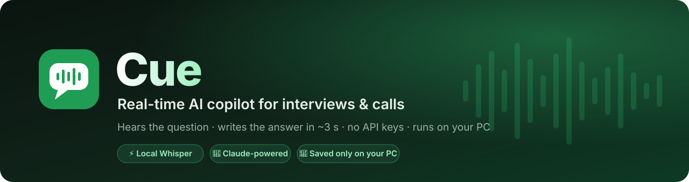
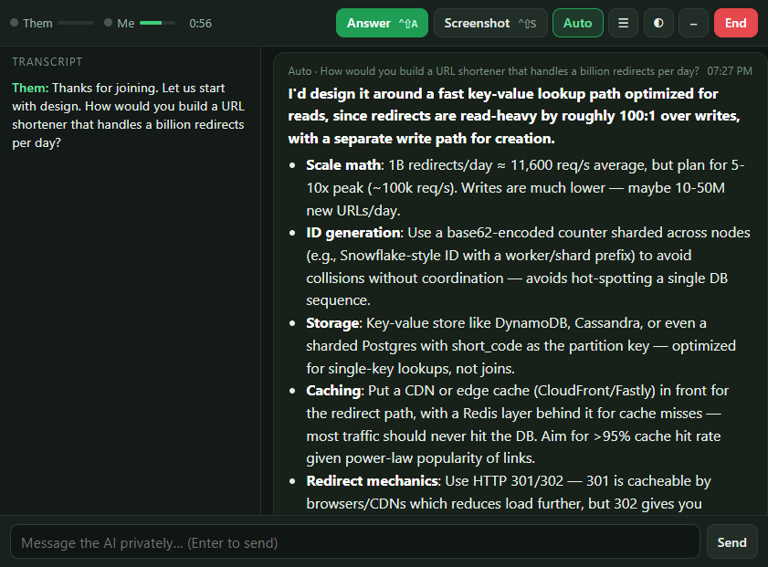
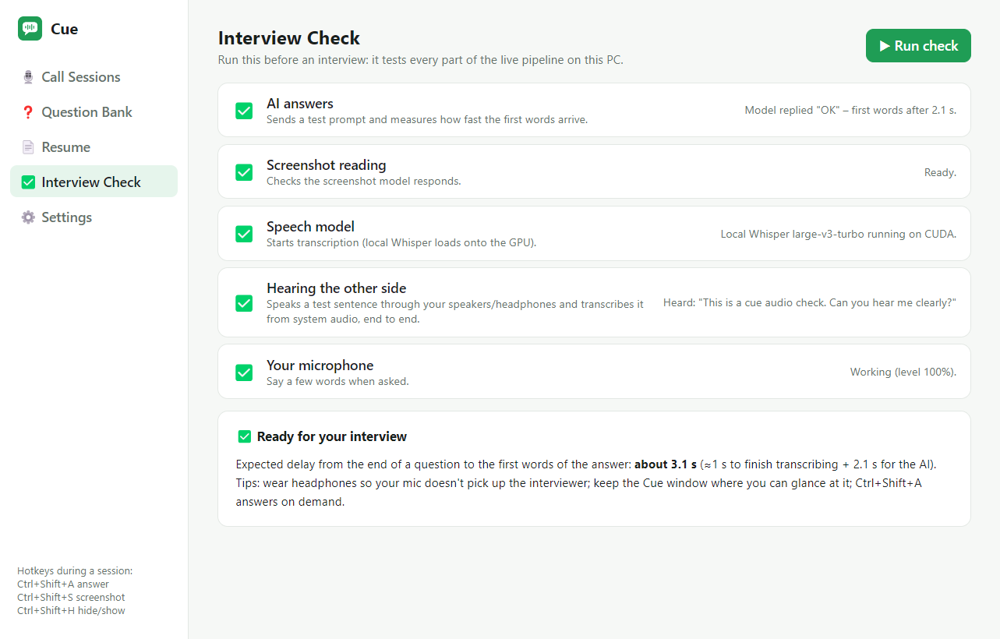
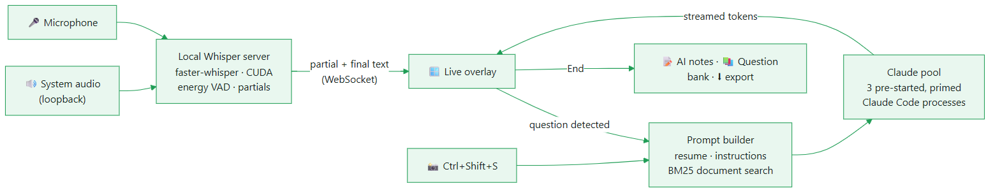

<div align="center">



<br/>

**Cue listens to your call, catches the question, and has the answer on your screen ~3 seconds after the other person stops talking.**<br/>
Free, open source, no API keys. Speech recognition runs on your own GPU.

<br/>

[](LICENSE)
[](#-quick-start)
[](https://www.electronjs.org/)
[](https://github.com/SYSTRAN/faster-whisper)
[](https://claude.com/claude-code)
[](#-contributing)

[](https://github.com/AnshulSharma9340/cue-interview-copilot/stargazers)
[](https://github.com/AnshulSharma9340/cue-interview-copilot/network/members)

[**Features**](#-features) · [**How it works**](#-how-it-works) · [**Quick start**](#-quick-start) · [**Speed**](#-speed-measured-not-promised) · [**FAQ**](#-faq) · [**Roadmap**](#-roadmap)

<br/>



<sub>A real answer. The question was spoken; Cue transcribed it locally and Claude streamed the reply.</sub>

</div>

---

## 🤔 Why Cue?

Real-time interview and meeting copilots are great until you see the price, around $20–$100 a month. They also send every second of your audio to someone else's servers. Cue does the same job on the hardware you already own:

| | Typical paid copilot | **Cue** |
|---|:---:|:---:|
| Price | $20–$100 / month | **Free, MIT licensed** |
| Speech-to-text | Cloud, metered | **Whisper on your GPU, unlimited, offline** |
| API keys needed | Their account | **None** (uses your signed-in Claude Code) |
| Where transcripts live | Their database | **Only on your PC** |
| Answer latency | ~1–3 s | **~3 s** (measured below) |
| Can you read the code? | No | **Every line** |

---

## ✨ Features

<table>
<tr>
<td width="50%" valign="top">

### 🎙️ Live transcription
Both sides of the call: **system audio** for the other person and your **microphone** for you. Words appear while people are still talking. Runs faster-whisper `large-v3-turbo` on CUDA and falls back to CPU automatically.

### ⚡ Auto Answer
Spots real questions and ignores filler like "okay, great". When the interviewer adds a follow-up, it starts the answer again with the full question. The answer streams word by word, in first person and ready to say out loud: a bold one-liner, then the supporting points.

### 📸 Screenshot solve
`Ctrl+Shift+S` captures your screen (Cue hides itself during the capture) and solves the coding or technical problem on it: approach, full code, then complexity.

### 💬 Private chat
Type to the AI mid-call ("make it shorter", "give an example from my last job"). It already has the transcript.

</td>
<td width="50%" valign="top">

### 🧠 Knows your story
Your **resume**, the session **instructions** (job description, up to 20k characters) and uploaded **documents** (PDF, DOCX, TXT). Long documents are searched with BM25, so only the relevant passages are sent.

### 🎭 Mock interviews
An AI interviewer **speaks** each question, listens to your spoken answer, gives feedback, then asks the next one. You can build a mock from questions you were actually asked.

### 📅 Meeting auto-detect
A popup appears when a Zoom, Teams, Google Meet, Webex or Slack huddle call starts, so you can start a session in one click.

### 📚 Question bank, notes and exports
Every question you were asked is collected in one place with "practise answer" buttons. AI notes (summary, action items, decisions) are written after every call. Sessions export to Markdown or PDF. There's also resume tailoring to any job description.

</td>
</tr>
</table>

### ✅ Interview Check: a one-click pre-flight

Before an interview, Cue tests the whole pipeline on your machine. It even plays a sentence through your speakers and transcribes it back from system audio, so you know it can hear the other side.

<div align="center"></div>

---

## ⚙️ How it works

<div align="center"></div>

<sub>Diagram source: <a href="docs/architecture.mmd"><code>docs/architecture.mmd</code></a></sub>

**The two tricks behind the speed:**

1. **Streaming local STT.** Audio goes from an `AudioWorklet` as 16 kHz PCM over a WebSocket to a Python faster-whisper server. Partial transcripts arrive every ~0.9 s. A 0.6 s pause ends the sentence, and the final text follows about 0.5 s later. There's no upload and no queue.
2. **A primed LLM pool.** Starting the Claude Code CLI costs 6–9 s, and its first request has extra setup. Cue keeps 3 processes **already started and primed** with one tiny exchange, so a real question pays only network time. Each process answers once, then is replaced in the background. Every process runs **sealed**: no tools, no MCP servers, no settings files, nothing written to disk.

---

## 🚀 Speed: measured, not promised

Measured on a laptop with an **RTX 2050 (4 GB)**. A question was spoken through the speakers and captured from system audio:

| Step | Time |
|---|---|
| Question stops → final transcript | **0.5 s** |
| Question stops → first words of the answer | **~3 s** (2–4 s depending on Claude's response time) |
| Whisper `large-v3-turbo` on a 7 s question | 0.55 s |
| Screenshot → first words | ~6–10 s (image upload through the CLI) |

> 💡 Want it faster? Switch **Answers** to Groq in Settings (free key) for sub-second first words.

---

## 📦 Quick start

### Requirements

- **Windows 10/11** and **Node.js 24+**
- **Python 3.10+** with `pip install faster-whisper websockets`. For GPU speed, also install a CUDA build of PyTorch (`pip install torch --index-url https://download.pytorch.org/whl/cu121`); without it Cue uses the CPU.
- **[Claude Code](https://claude.com/claude-code)**, installed and signed in (`claude` on PATH or in `~/.local/bin`). Cue uses your Claude plan, so there's no API key to manage.

### Run

```bash
git clone https://github.com/AnshulSharma9340/cue-interview-copilot.git
cd cue-interview-copilot
npm install
npm start
```

### Build the installer

```bash
npm run dist        # → dist/Cue-Setup-2.0.0.exe  (per-user install, desktop shortcut)
```

> The first start downloads the Whisper model (~1.6 GB, once). After that it loads onto the GPU in about 20 s.

---

## 🎯 Using it in an interview

1. **Resume** page: upload your resume (PDF or DOCX).
2. **Create Session**: choose *Interview*, paste the job description into *Instructions*, and attach any prep docs.
3. Run **Interview Check** once. Everything should be green.
4. Join the call, then press **Start**. Put the overlay where you can glance at it.
5. Wear **headphones**, so your mic only hears you.

| Hotkey | Action |
|---|---|
| `Ctrl+Shift+A` | Answer the latest question now |
| `Ctrl+Shift+S` | Screenshot → solve what's on screen |
| `Ctrl+Shift+H` | Hide / show the overlay |
| `Ctrl+Enter` | Answer (when the overlay is focused) |

---

## 🔌 Providers

Every slot is swappable in **Settings**, and any OpenAI-compatible API works.

| Slot | Default (no key) | Also supported |
|---|---|---|
| Answers & chat | **Claude** (Sonnet 5 via Claude Code) | Groq, Gemini, OpenAI, Ollama (local), claude-bridge, custom |
| Screenshot reading | **Claude** | Gemini, OpenAI, Ollama (LLaVA), claude-bridge |
| Transcription | **Local Whisper** (GPU) | Groq Whisper, OpenAI Whisper |

---

## 🗂️ Project structure

```
main.js                 Electron main process: windows, IPC, hotkeys, screen capture, exports
preload.js              the only bridge between pages and the main process
src/
  claude-direct.js      primed Claude Code process pool (sealed, streaming)
  stt-local.js          starts and supervises the Whisper server
  ai.js                 OpenAI-compatible client + claude-bridge support
  prompts.js            answer / chat / screenshot / notes / mock / resume prompts
  rag.js                BM25 chunk search over documents
  meetings.js           meeting detection from window titles
  store.js              settings + sessions (JSON in %APPDATA%\Cue, keys encrypted with DPAPI)
stt/stt_server.py       streaming Whisper over WebSocket (VAD, partials, finals)
renderer/               dashboard (app.js, pages.js) + live overlay (overlay.*), audio worklet
```

---

## ❓ FAQ

<details>
<summary><b>Does it need an internet connection?</b></summary>

Transcription is fully offline. Answers come from Claude (or whichever provider you pick), so those need a connection. With **Ollama** as the provider, everything runs offline.
</details>

<details>
<summary><b>Where is my data stored?</b></summary>

Sessions, transcripts, notes and settings are stored in `%APPDATA%\Cue` on your PC, and API keys are encrypted with Windows DPAPI. The only thing that leaves your machine is the text (and screenshots) sent to the AI provider you chose to answer with.
</details>

<details>
<summary><b>No NVIDIA GPU?</b></summary>

Cue falls back to CPU with `small.en`. That works, but it's slower. You can also switch Transcription to Groq (free key).
</details>

<details>
<summary><b>macOS / Linux?</b></summary>

Not yet. System-audio loopback and meeting detection are Windows-specific today. PRs are welcome (see the roadmap).
</details>

<details>
<summary><b>Is it hidden from screen sharing?</b></summary>

No, and that's deliberate. Cue doesn't hide itself from screen sharing, task managers or proctoring software.
</details>

---

## 🛣️ Roadmap

- [x] Streaming local Whisper with partial transcripts
- [x] Primed Claude pool, ~3 s to first words
- [x] Mock interviews, question bank, resume tailoring
- [x] Meeting auto-detect, Interview Check, PDF export
- [ ] Speaker diarization for multi-interviewer panels
- [ ] Silero VAD + speculative answering on partials (aiming for under 2 s)
- [ ] macOS support (ScreenCaptureKit audio)
- [ ] Bundled Python runtime (one-click install, no pip)
- [ ] Answer-quality scoring and spaced-repetition practice

---

## 🤝 Contributing

Issues and PRs are welcome. Good first issues: new meeting-app rules in `src/meetings.js`, more languages in `src/languages.js`, and UI polish.

```bash
npm start                               # dev run
node --check main.js src/*.js           # quick syntax check
python -m py_compile stt/stt_server.py
```

If Cue helped you land an interview, a ⭐ helps other people find it.

---

## ⚖️ Responsible use

Cue is built for conversations where AI assistance is allowed: practice, mock interviews, sales and client calls, meetings, language practice and self-study. **Follow the rules of your interview, exam or employer.** If they say no AI, respect that.

---

<div align="center">

**MIT © 2026 [Anshul Sharma](https://github.com/AnshulSharma9340)**

<a href="https://star-history.com/#AnshulSharma9340/cue-interview-copilot&Date">
  
</a>

</div>
